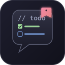
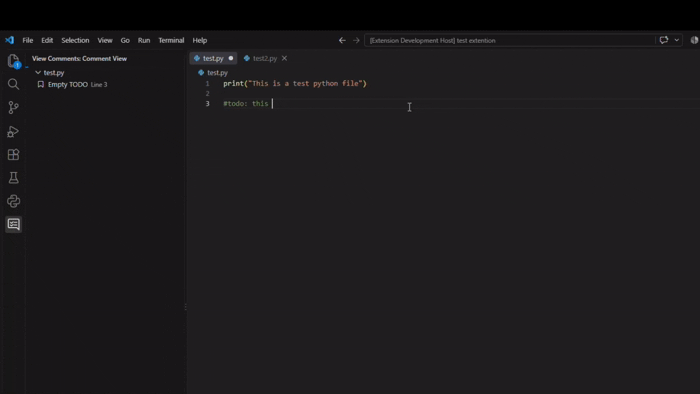
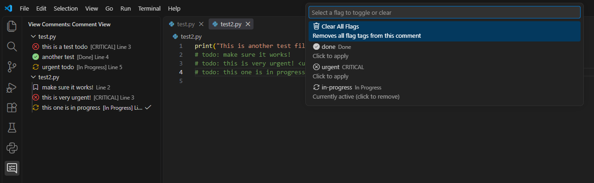

# Comment View

<p align="center">
  
</p>

<p align="center">
  <strong>Organize, track, and manage code TODOs directly from your VS Code sidebar.</strong>
</p>

---

## 🌟 Overview

**Comment View** scans your workspace for inline `todo:` comments and structures them into a clean, hierarchical tree view grouped by file. Customize your workflow with dynamic `<flag>` tags (like `<done>`, `<urgent>`, or `<review>`) and map them directly to custom icons, colors, and descriptions.

---

## 🚀 Key Features

### 1. Tree View Grouped by File
Automatically scans open workspace files and organizes comments by file paths for fast navigation.



---


---

### 2. Custom Flag Parsing & Styling
Add trailing `<flag>` tags to comments to instantly change their appearance in the sidebar tree.

```typescript
// todo: Fix memory leak in auth provider <urgent>
# todo: Complete API integration test <done>
/* todo: Code review pending <review> */

```

---

### 3. Context Menu Actions

Right-click any comment in the sidebar or click the hover actions to quickly toggle completion or set custom flags.

---

## ⚙️ Extension Settings

### Custom Flags (`commentView.flags`)

Define your own flags in VS Code **Settings** (`settings.json`) under `commentView.flags`:

```json
"commentView.flags": {
  "done": {
    "icon": "pass-filled",
    "color": "disabledForeground",
    "description": "Done"
  },
  "urgent": {
    "icon": "flame",
    "color": "charts.red",
    "description": "HIGH PRIORITY"
  },
  "in-progress": {
    "icon": "sync",
    "color": "charts.yellow",
    "description": "In Progress"
  },
  "review": {
    "icon": "eye",
    "color": "charts.blue",
    "description": "Needs Review"
  }
}

```

#### Setting Properties

| Property | Type | Description | Example |
| --- | --- | --- | --- |
| `icon` | `string` | Any valid [VS Code Codicon](https://microsoft.github.io/vscode-codicons/dist/codicon.html?utm_source=gemini) identifier | `flame`, `pass-filled`, `star` |
| `color` | `string` | Native VS Code Theme Color token | `charts.red`, `disabledForeground` |
| `description` | `string` | Label suffix displayed in the tree view item | `[URGENT]`, `[Done]` |

---

### Exclude Glob Patterns (`commentView.exclude`)

Configure glob patterns to bypass heavy folders (e.g. `.venv`, `node_modules`, or build artifacts) during workspace scans:

```json
"commentView.exclude": [
  "**/node_modules/**",
  "**/.venv/**",
  "**/venv/**",
  "**/.git/**",
  "**/dist/**",
  "**/build/**"
]

```

---

## 📦 License

This extension is licensed under the [MIT License](https://www.google.com/search?q=LICENSE&utm_source=gemini).
